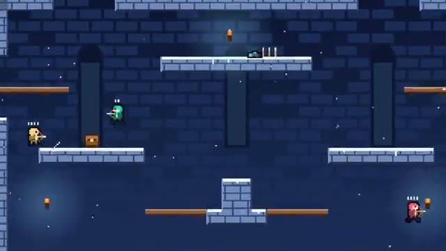

# Quiver Clash

One arrow, one life. Last archer standing wins. A multiplayer starter game from [Multiplayer Agent](https://multiplayeragent.com): 2D, versus, 2–4 players, with bots that fill empty seats.

## How it plays

Shoot in eight directions from a quiver of three, and pull your arrows back out of the walls. A dodge at the right moment catches an arrow out of the air, and landing on a head counts too. The edges wrap around. Last one standing takes the round; first to three rounds wins.

**Controls:** Arrow keys with Z, X and C, or a thumb stick with Jump, Shoot and Dodge.

## Make it yours in the Game Builder

Open the [Game Builder](https://multiplayeragent.com), choose **Start from a starter game** and pick Quiver Clash. It opens as version 1 in your studio, ready to play and publish. Then ask for changes, for example:

- Add a laser arrow that goes straight through walls
- Make it a jungle arena with vines you can climb
- Give everyone a shield that blocks one arrow

## Run it yourself

1. Get a free publishable key (`pk_…`) at [multiplayeragent.com](https://multiplayeragent.com).
2. In `index.html`, put it in place of `pk_REPLACE_ME` in the `MP_CONNECT` block.
3. Open `index.html` in a browser. No build step and no server needed.

Without a key it still runs, offline against bots.

## How it is built

- One `index.html`. The comment at the top of the script maps the code and explains the multiplayer.
- **Leaderboard:** The players with the most match wins.
- **Host-run rounds:** The host's browser calls each round, keeps score and hands out the arrows lying around and the chests; if it leaves, the next player takes over.
- **Bots:** Bots fill the empty seats: they hunt, dodge, catch arrows and go back for more.
- **Live sync:** Every archer and every arrow in flight shows up on all screens at once.
- An arrow hit is decided on the screen of the archer it hits (that's where a dodge is timed); a stomp on the stomper's screen.
- `?attract` runs it offline with bots only. The preview video is recorded from it.

## License

MIT.
